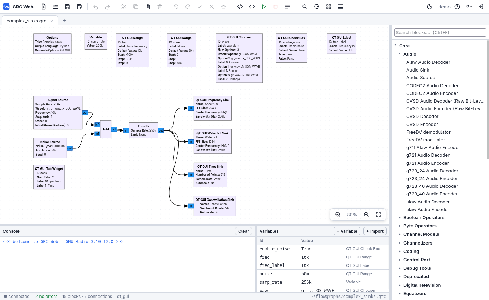
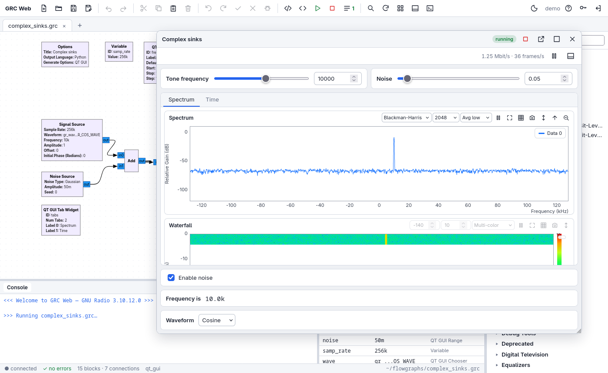
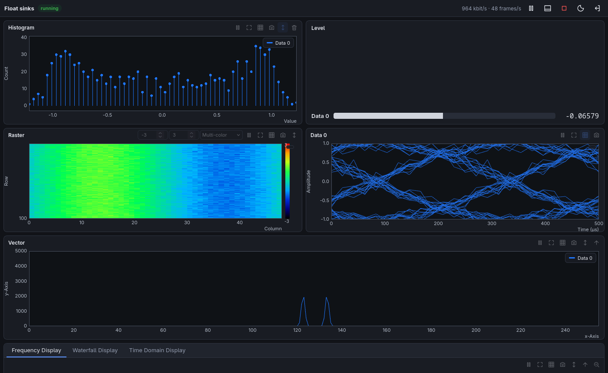
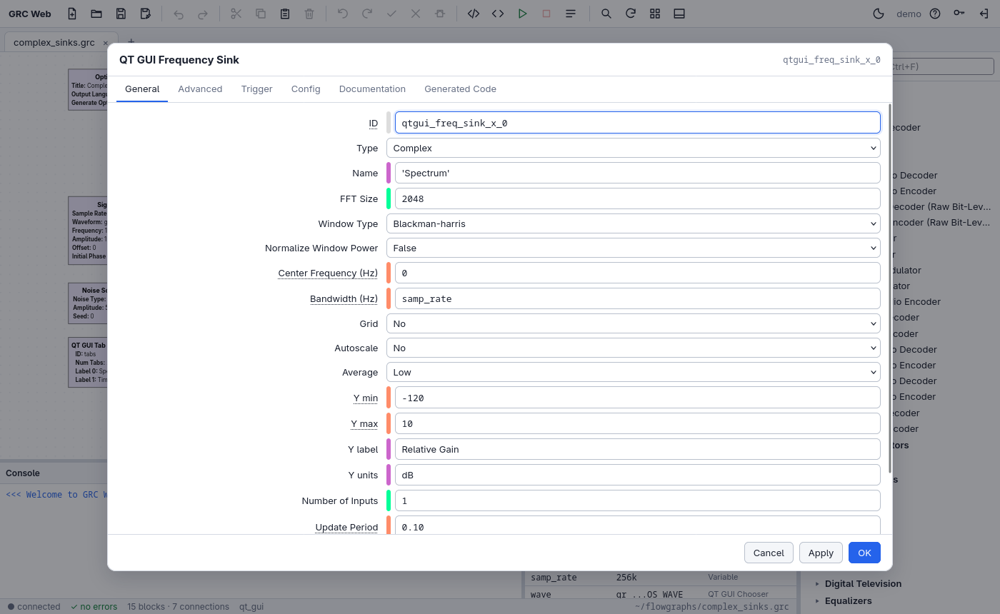
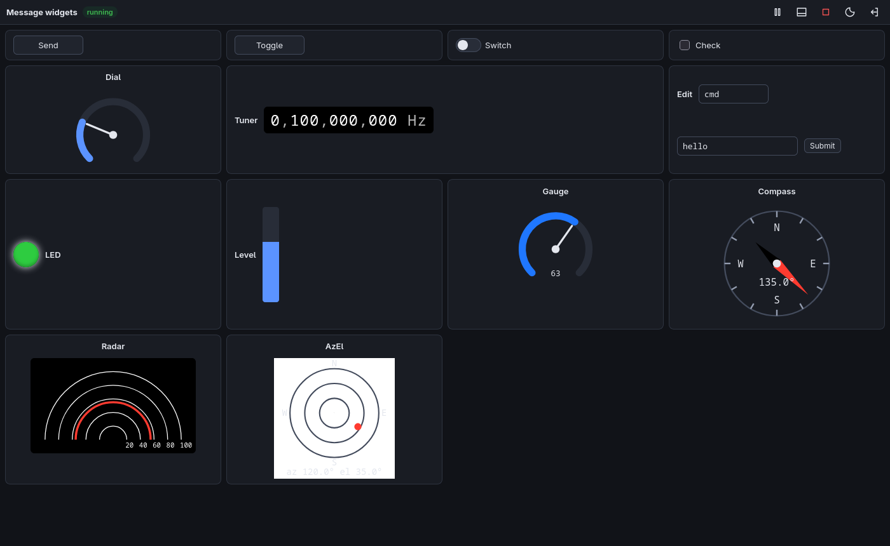
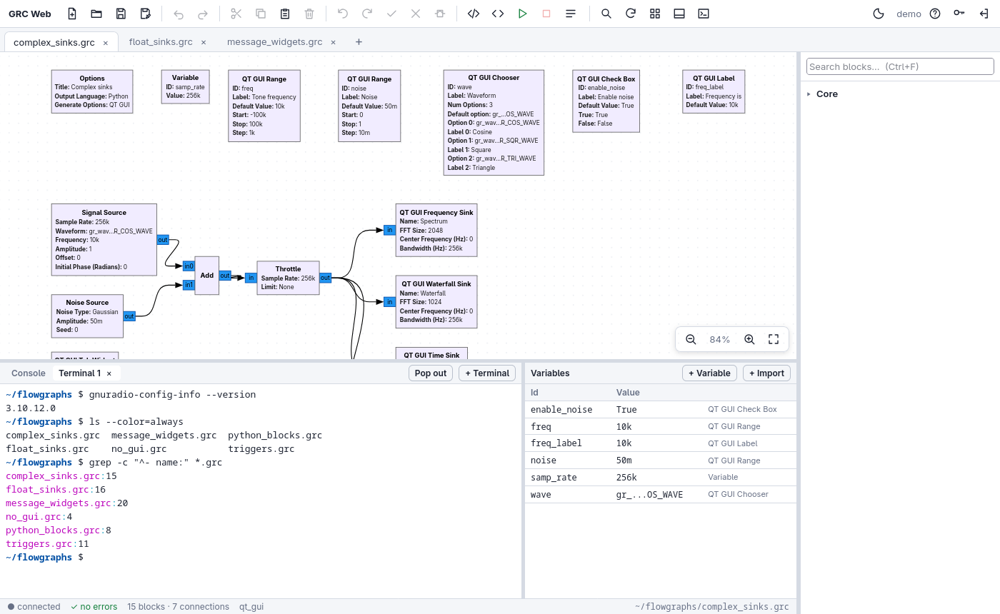
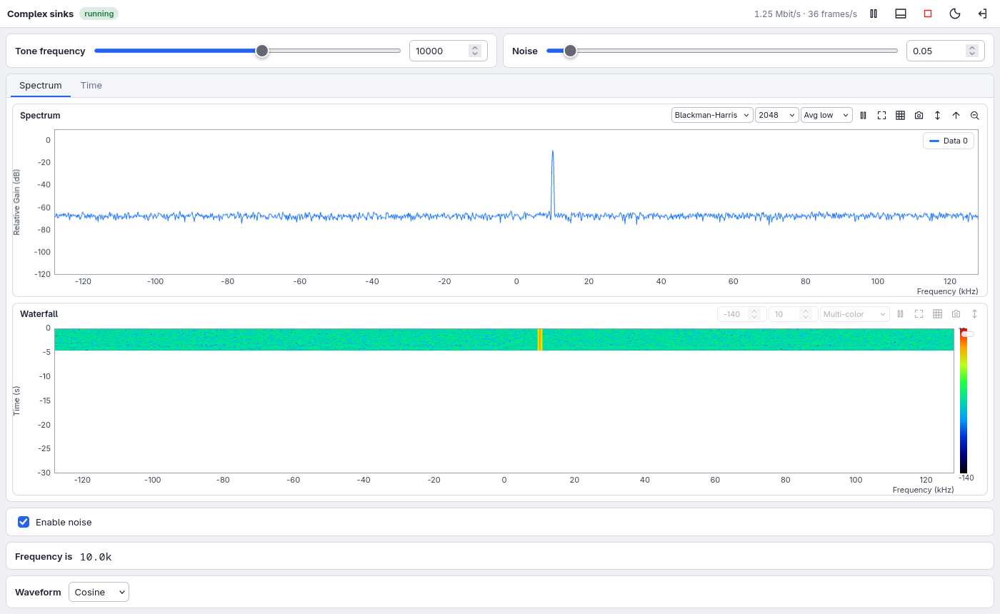

# GRC Web

**GNU Radio Companion in the browser.** Design, run and watch GNU Radio flow
graphs on a remote machine from any web browser: no X11 forwarding, no remote
desktop. All signal processing runs on the server; the browser only receives
the reduced data it draws (spectra, traces, waterfall rows…), so the plots
stay smooth even over modest network links.



GRC Web is **not a re-implementation of GRC**. It runs on top of the
unmodified GNU Radio Companion core (`gnuradio.grc.core`): block discovery
(including out-of-tree modules), parameter evaluation, validation, `.grc`
reading/writing and code generation are exactly those of the desktop
application. A flow graph saved from the browser is byte-for-byte the file
GRC itself would write, so you can switch between both freely.

| Running flow graph inside the editor | Plots and widgets (dark theme) |
|---|---|
|  |  |
| **Block properties, validated live by the GRC core** | **Message widgets and indicators** |
|  |  |
| **A shell on the server, next to the console** | **A flow graph in its own browser tab** |
|  |  |

## Features

* **Editor that behaves like GRC**: block library with search, drag-and-drop,
  connecting ports by dragging, live-validated properties (errors shown like
  in GRC), undo/redo, copy/paste, rotate, enable/disable/bypass, variables
  panel, console, generate, hier blocks, GRC keyboard shortcuts, light and
  dark themes, SVG/PNG export of the diagram.
* **Python blocks and modules** edited in a built-in code editor; the GRC core
  re-extracts ports and parameters when you apply.
* **Execution from the browser**: the generated flow graph runs as a process
  on the server. Its GUI opens in a window laid out from the *GUI hints* and
  *QT GUI Tab Widgets*, like the Qt window. It keeps running if you close the
  window or lose the connection; reopen it at any time.
* **Terminal**: shells on the server in the bottom panel, next to the
  console, with colours and full-screen programs (`vim`, `htop`…). They keep
  running when you reload or close the page and can be popped out to their
  own browser tab. Handy for installing OOT modules, checking devices or
  looking at files without a separate SSH session.
* **Plots written from scratch in WebGL2** (with an automatic Canvas 2D
  fallback): time, frequency, waterfall, constellation, histogram, number,
  vector, time raster, eye, combined *QT GUI Sink* and auto-correlation, with
  zoom, pan, autoscale, max/min hold, averaging, FFT size and window, triggers
  and tags, colour maps and PNG snapshots.
* **Multi-user with login**: every page requires an account. Users see which
  flow graphs are running; only the owner or an admin can stop them.
* **Out-of-tree modules** (Soapy, gr-satellites, gr-osmosdr, your own) are
  found the same way GRC finds them.
* **Autosave**: open documents, including unsaved changes, survive a server restart.
* **No CDN and no build step**: the server itself serves everything the
  browser needs (the only third-party front-end code, xterm.js, is included),
  so it works on servers without Internet access.

## Requirements

* Linux (macOS should work but is untested; Windows is not supported).
* GNU Radio 3.10 including GNU Radio Companion, and the Python it is
  installed for (tested with 3.10.12 and Python 3.14). For example:
  * Debian / Ubuntu: `sudo apt install gnuradio python3-venv`
  * Fedora: `sudo dnf install gnuradio`
  * Arch Linux: `sudo pacman -S gnuradio gnuradio-companion`
  * conda / radioconda: `conda install -c conda-forge gnuradio`
* [aiohttp](https://docs.aiohttp.org/). The launcher installs it in a virtual
  environment unless your distribution already provides it (`python3-aiohttp`).
* A recent web browser (Firefox, Chrome, Edge, Safari).

## Quick start

```bash
git clone https://github.com/Malaga-Space-Team/gr-web.git
cd gr-web
./grc-web user add alice --admin      # asks for a password (8+ characters)
./grc-web serve                       # http://127.0.0.1:8410
```

On first use `./grc-web` creates `.venv/` on top of the Python that has GNU
Radio (its packages stay visible). Set `GRCWEB_PYTHON=/path/to/python3` to
choose another interpreter, e.g. a conda environment.

As an alternative to the launcher, install it as a package in an environment
where `import gnuradio` works:

```bash
pip install .
grc-web serve
```

### Options

| `grc-web serve` option | Meaning |
|---|---|
| `--host 0.0.0.0` | listen on all interfaces (default: `127.0.0.1` only) |
| `--port N` | port (default 8410) |
| `--tls` | HTTPS with the certificate created by `grc-web cert` |
| `--certfile FILE --keyfile FILE` | HTTPS with your own certificate |
| `--root DIR` | folder offered by the file browser (repeatable; default: your home) |
| `--no-terminal` | disable the terminal |

Persistent settings can go in `~/.config/grc-web/config.json` with the same
names (`host`, `port`, `certfile`, `keyfile`, `roots`, `terminal`) plus
`session_idle_hours`, `max_runs_per_user` and `max_terminals_per_user`.

## Remote access

1. **SSH tunnel (recommended, nothing is exposed to the network):**
   ```bash
   ssh -L 8410:127.0.0.1:8410 user@sdr-host
   ```
   then open `http://localhost:8410` on your laptop.
2. **Direct HTTPS:**
   ```bash
   ./grc-web cert sdr-host.example.org 192.168.1.50   # self-signed certificate
   ./grc-web serve --host 0.0.0.0 --tls
   ```
3. **Behind a reverse proxy** that terminates TLS (nginx, Caddy…): forward the
   WebSockets (`/ws` and `/ws/term`) as well and set the `X-Forwarded-Proto`
   header.

If the server listens beyond localhost without TLS, it warns that passwords
would travel in clear text.

### Running it as a service

```bash
mkdir -p ~/.config/systemd/user && cp contrib/grc-web.service ~/.config/systemd/user/
systemctl --user daemon-reload && systemctl --user enable --now grc-web
loginctl enable-linger "$USER"     # keep it running after logging out
```

Edit the path and options in the unit file first. Environment variables
(`GRC_BLOCKS_PATH`, `PYTHONPATH`, …) go in `Environment=` lines.

## Users and security

```bash
./grc-web user list
./grc-web user add NAME [--admin]
./grc-web user passwd NAME
./grc-web user del NAME
```

Changes apply to a running server immediately; the sessions of a deleted
user end at once.

* Everything (pages, static files, API and WebSocket) requires a session;
  the login page is the only public page.
* Passwords are hashed with scrypt. Sessions use `HttpOnly`,
  `SameSite=Strict` cookies (plus `Secure` over HTTPS) and expire after
  12 hours of inactivity.
* After 5 failed attempts the login is locked, with increasing delays, per
  user name and per client address.
* Cross-origin requests and WebSockets are rejected. The server also sends
  CSP, `X-Frame-Options` and `nosniff` headers.
* Each user has their own open documents and terminals.

**Important:** like GRC itself, GRC Web runs arbitrary code (Python blocks,
expressions, flow graphs) **as the operating system user that runs the
server**, and its terminal is a shell with those same rights. Only give
accounts to people you would trust with a shell on that machine. See
[SECURITY.md](SECURITY.md).

## Using it

**Editor.** The block library is on the right, the canvas in the middle and
the console and variables at the bottom. Searching the library filters it
while keeping the categories of the matching blocks; ↑/↓ choose a result and
Enter adds it. Drag with the right mouse button (or the middle one, or
Space+drag, or scroll) to move around the canvas; a right click without
moving opens the menu. Double click a block (or press
Enter) to edit its properties. The `?` button lists all keyboard and mouse
shortcuts, which follow GRC (E/D/B enable/disable/bypass, arrows rotate and
change types, F5/F6/F7 generate/execute/kill…). Several users or browser
tabs can work against the same server; your open documents are autosaved
every few seconds to `~/.local/state/grc-web/workspaces/`.

**Execute (F6).** The flow graph window opens as a floating window, or in its
own browser tab with the "open in a new tab" button. The run menu in the
toolbar lists every running flow graph so you can reconnect later.

**Terminal.** Ctrl+` (the key below Esc) or the terminal button in the
toolbar opens a shell on the server in the bottom panel; press it again to go
back to the canvas. *+ Terminal* opens more (up to 8 per user). It is your
login shell, started in the first `--root` folder as the account that runs
the server. It keeps running when you reload or close the page, and the
recent output comes back when you return; *Pop out* shows the same shell in
its own browser tab. Copy with Ctrl+Shift+C (or Ctrl+C while text is
selected) and paste with Ctrl+V; right click for a menu. Closing its tab ends
the shell and everything started from it, and so does restarting the server.

**Plots.**

| Action | Effect |
|---|---|
| Drag | box zoom |
| Right click | reset zoom |
| Wheel / Shift+wheel | zoom X / zoom Y |
| Shift+drag | pan |
| Double click (frequency and waterfall plots) | send that frequency on the `freq` message port, like the Qt sinks |

Each plot also has pause, autoscale, grid and snapshot buttons, plus
sink-specific controls: trigger panel, FFT settings, colour map and
intensity range.

## Out-of-tree modules

Blocks are loaded by GRC itself, so OOT modules appear just as they do in
the desktop application. GRC reads the `.block.yml` files from:

* `<prefix>/share/gnuradio/grc/blocks`;
* `GRC_BLOCKS_PATH`;
* `[grc] local_blocks_path` and `global_blocks_path` in the GNU Radio configuration;
* the hier block folder (`~/.local/state/gnuradio`).

* Installed in the same prefix as GNU Radio (distribution packages,
  `cmake -DCMAKE_INSTALL_PREFIX=/usr`): nothing to do.
* Installed elsewhere (`/usr/local`, `/opt/...`): as with GRC, export
  `GRC_BLOCKS_PATH` and `PYTHONPATH` before starting the server. The flow
  graphs inherit its environment.
* Installed while the server is running: press *Reload block library* in the
  toolbar. There is no need to restart, and open documents are reloaded.

Hardware blocks (Soapy, UHD…) run on the server, so they use the devices
attached to that machine, with the permissions (udev rules) of the user
running `grc-web`.

## Qt GUI blocks

When a flow graph is executed from the browser, its Qt GUI blocks are
replaced by web equivalents with the same parameters and ports. The `.grc`
file is not modified.

* **Sinks**: Time, Frequency, Waterfall, Constellation, Histogram, Number,
  Vector, Time Raster, Eye, QT GUI Sink and Fast Auto-Correlator. They
  support message (PDU) inputs, Free/Auto/Normal/Tag triggers with delay,
  tag display and multiple inputs.
* **Controls**: Range, Chooser, Check Box, Push Button, Entry, Label, Toggle
  Button, Toggle Switch, Msg CheckBox, Msg Push Button, Dial, Digital Number
  Control and Message Edit Box.
* **Indicators**: LED, Level Gauge, Dial Gauge, Compass, Distance Radar,
  Az-El Plot and Graphic Item.
* **Layout**: Tab Widget and GUI hints.

Qt blocks without a web version (BER curve sink, Graphic Overlay,
`uhd_msg_push_button`, Qt widgets of OOT modules) are replaced by a
placeholder with the same ports. The flow graph still runs, but that block
shows nothing.

### Known limitations

* Hier blocks generated as *Hier Block (QT GUI)* contain Qt code and run as
  placeholders; regular hier blocks work.
* C++ flow graphs are executed through their Python templates.
* Hand-written Qt code in Python blocks or snippets is not displayed. Flow
  graphs run with `QT_QPA_PLATFORM=offscreen`, so no window ever opens on
  the server.
* Bokeh GUI output is not supported.

## Performance

Like the Qt sinks, the web sinks take a snapshot of the latest samples once
per update period and consume everything else untouched. What travels to the
browser is already reduced:

* at most 4096 points per plot;
* waterfall rows quantized to 8 bits.

Every stage (flow graph process, server, each browser connection) keeps only
the latest frame. A slow connection loses intermediate frames but never
slows the flow graph down.

As a reference, `tests/perf.py` on a 12-thread desktop CPU used a 20 Msps
complex stream feeding a frequency sink (FFT 4096), a waterfall, a time sink
and a constellation sink. The results:

* about 2.8 Mbit/s to the browser at 40 frames per second;
* about a quarter of one CPU core on top of the same flow graph with null sinks.

## How it works

```
Browser  ── HTTPS / WebSocket ──►  grc-web server (Python, aiohttp)
  SVG editor                          │  gnuradio.grc.core (unmodified)
  WebGL2 plots                        │  ├─ "editor" platform: original blocks
                                      │  └─ "run" platform: Qt GUI blocks → web blocks
                                      ▼
                          flow graph process (Python generated by GRC)
                          + grcweb.runtime (web sinks/widgets) ── unix socket ──► server
```

```
grcweb/
  platforms.py   GRC platforms (editor and run) on the unmodified core
  translate.py   Qt GUI blocks → web templates in the "run" platform
  document.py    an open flow graph: editing operations, undo, diffs
  serialize.py   JSON views of blocks, ports and parameters
  layout.py      GUI hints and tab widgets → run window layout
  runner.py      generation, child process, link with the runtime
  terminal.py    shells on pseudo-terminals for the browser terminal
  server.py      aiohttp: login, files, WebSockets, autosave
  auth.py        users (scrypt), sessions, login throttling
  runtime/       imported by the generated flow graph: web sinks and widgets
  static/        front-end without build step (editor, run window, WebGL plots,
                 terminal); vendor/ holds xterm.js
tests/           runtime, server, browser and performance tests
contrib/         systemd unit
```

## Development and tests

```bash
.venv/bin/python tests/make_flowgraphs.py                # rebuild tests/flowgraphs/*.grc
.venv/bin/python tests/run_examples.py tests/flowgraphs  # run each one through the web runtime
.venv/bin/python tests/test_server.py                    # login, permissions, editing, runs, hier blocks, terminals
.venv/bin/python tests/perf.py                           # CPU cost at a high sample rate
```

Browser test with a real Firefox (editor, execution, plots, widgets, Python
blocks, terminal). Under `xvfb-run` Firefox has WebGL; `--headless` exercises the
Canvas 2D fallback:

```bash
xvfb-run -a -s "-screen 0 1600x1000x24" .venv/bin/python tests/test_ui.py
.venv/bin/python tests/test_ui.py --headless
```

Contributions are welcome; see [CONTRIBUTING.md](CONTRIBUTING.md).

## License

Copyright © 2026 Málaga Space Team.

GRC Web is free software: you can redistribute it and/or modify it under the
terms of the GNU General Public License as published by the Free Software
Foundation, either version 3 of the License, or (at your option) any later
version, the same license as GNU Radio. It is distributed in the hope that
it will be useful, but WITHOUT ANY WARRANTY. See [LICENSE](LICENSE) for the
full text.

GRC Web uses GNU Radio and GNU Radio Companion at run time; they are not
part of this repository. A few display helpers in `grcweb/serialize.py` are
adapted from GNU Radio Companion and keep their original copyright notice.
The terminal uses [xterm.js](https://github.com/xtermjs/xterm.js) (MIT
license), included in `grcweb/static/vendor/xterm/` with its license.
GRC Web is an independent project, not affiliated with or endorsed by the
GNU Radio project.
